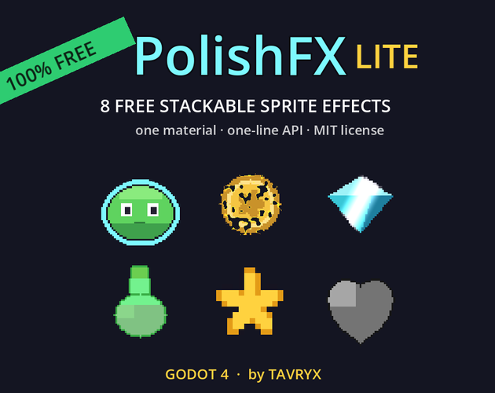
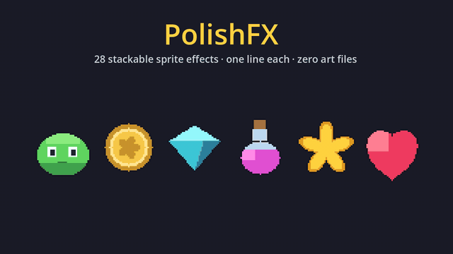

# ✨ PolishFX Lite — Free Stackable 2D Sprite Effects for Godot 4



**8 sprite effects. One material. Zero art files. MIT licensed.**
Hit-flash, outline, dissolve, shine, tint, fade, pixelate and grayscale —
stackable on a single ShaderMaterial, configurable from the Inspector, and
drivable from code with one line.

**Download:** clone this repo, grab the [latest ZIP](https://github.com/tavryxlabs-lab/polishfx-lite/archive/refs/heads/main.zip),
or get it on itch.io: [tavryx.itch.io/polishfx-lite](https://tavryx.itch.io/polishfx-lite).

- **Godot 4.4 – 4.7+** — verified on 4.4.1, 4.5, 4.6 and 4.7 across the
  Forward+, Mobile and Compatibility renderers, on desktop and in web
  exports. Pure GDScript + one canvas shader, no platform-specific code
  (mobile-device exports should work, but aren't field-tested yet)
- **Per-node live params** — hundreds of sprites can **share one material** and
  still flash/dissolve individually (instance uniforms — no material
  duplication, no "all enemies flash at once" bug)
- **One-line API** — `PolishFX.flash($Sprite2D)` — static class, **no autoload**
- Works on any CanvasItem: `Sprite2D`, `AnimatedSprite2D`, `TextureRect`…
- Pure GDScript + one shader. No C# required, no dependencies, no image files.

## Install (30 seconds)

1. Copy the `polishfx/` folder anywhere into your project (`res://polishfx/`
   recommended — it's what the full version requires for its presets).
2. Done — no autoload, no plugin to enable.

## Quick start

```gdscript
PolishFX.flash($Enemy)                          # classic white hit flash
PolishFX.tint($Enemy, Color.GREEN, 0.6)         # poison status (until untint)
PolishFX.shine($Coin)                           # gleam sweep
PolishFX.pulse_outline($Target, Color.YELLOW)   # selection pulse

await PolishFX.dissolve_out($Enemy).finished    # burn away, then…
$Enemy.queue_free()
```

Or use no code at all: assign `polishfx/polishfx.gdshader` as the sprite's
**Material** and toggle effects in the Inspector.

## The 8 Lite effects

`hit flash · tint · outline · dissolve (burn edge) · shine sweep · fade ·
pixelate · grayscale`

## Known limitations

- **Packed spritesheets (hframes/vframes, Region, AtlasTexture):** the color
  effects (flash, tint, grayscale, fade) work per-frame everywhere; **shine**
  maps across the whole sheet, **outline** can pull neighbouring frames in,
  **pixelate** blocks can straddle a frame border and sample the neighbour
  (reach ≤ half the block size), and the **dissolve** pattern shifts per
  frame — for those, use one-texture-per-frame sprites (SpriteFrames from
  separate images, as most Aseprite importers produce).
- **Live-param sprite budget:** instance uniforms share one engine buffer —
  about ~250 CanvasItems can carry live params at once on typical hardware.
- Outline needs a little transparent padding around the sprite's pixels
  (texture edges clip it).
- A pure-white `flash()` is invisible on vertex-colored geometry (Label,
  ColorRect, Line2D…) — use a colored flash there.
- `modulate`/`self_modulate` are respected (they multiply the final result).
- One material per CanvasItem (Godot rule) — PolishFX can't stack on top of
  another custom material on the same node.

**Running headless / in CI?** Like any Godot project, a freshly-copied
project must be imported once before a headless run:
`godot --headless --import` — otherwise the first `--headless` run can fail
or stall (script class cache and resource imports don't exist yet).

## Want the other 20?



**[PolishFX (full)](https://tavryx.itch.io/polishfx)** adds: glow, glitch +
RGB split, hologram, freeze, **squash & stretch**, sprite shake, HSV shift,
rainbow, bulge, wave (jelly), ghost, sway, drop shadow, posterize, sepia,
invert, brightness/contrast, flicker, UV scroll, static tint — plus **14
ready-made presets** (frozen, golden, neon, cursed…) and the interactive
gallery scene. There's a **browser demo on the itch page where you can try
everything before buying**.

## Issues & feedback

Bug reports and feature requests are welcome in
[GitHub Issues](https://github.com/tavryxlabs-lab/polishfx-lite/issues) or on
the [itch.io page](https://tavryx.itch.io/polishfx-lite). Requests that come up
repeatedly shape the 1.x updates.

## License

MIT — free for any use, including commercial games. Credit appreciated,
not required. See [LICENSE.txt](LICENSE.txt).

---

**More juice:** its sibling [**KapowFX**](https://tavryx.itch.io/kapowfx)
makes your *moments* hit hard: spawnable 2D explosions, impacts, slashes and
magic + screen shake, hitstop, damage popups and screen transitions. The free
[KapowFX Starter](https://tavryx.itch.io/kapowfx-starter) pairs perfectly with
this pack. Made by **Tavryx**.
